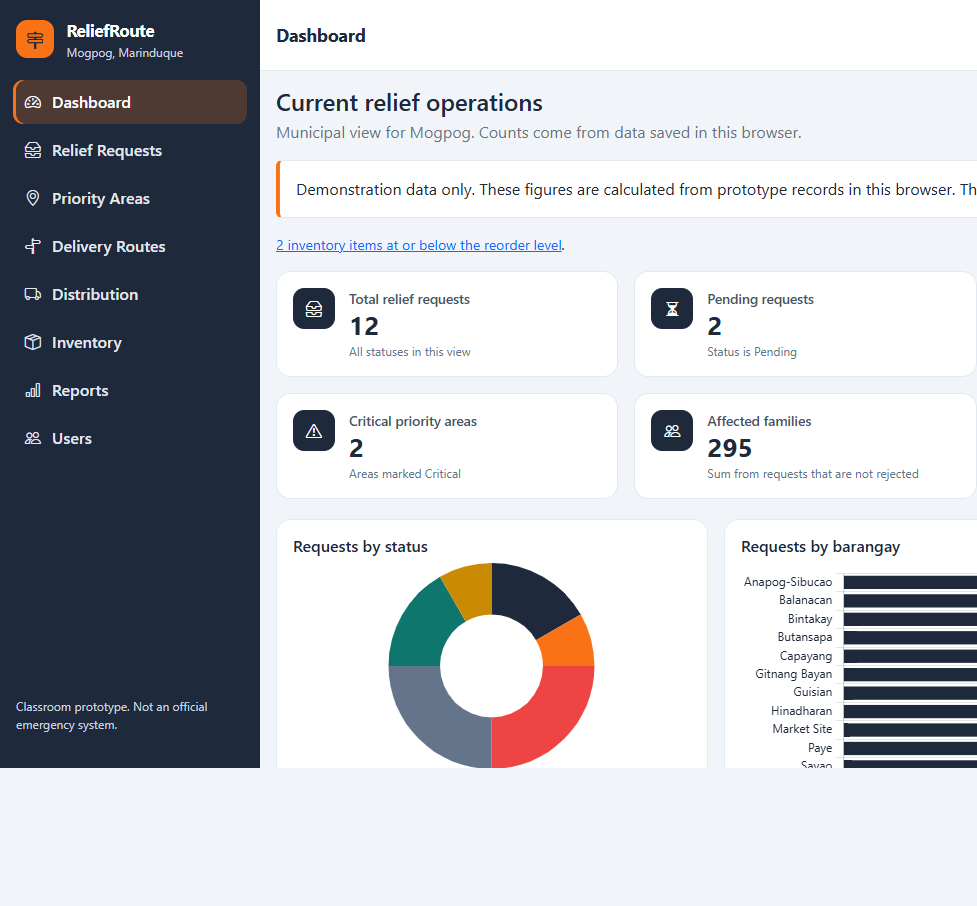
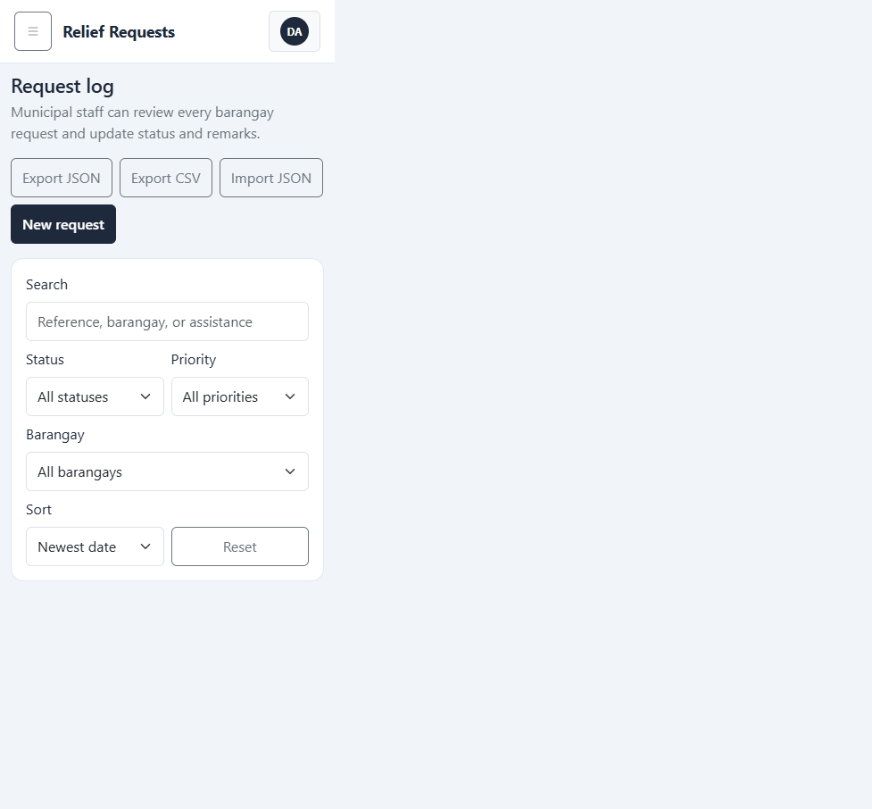

# ReliefRoute: A Browser-Based Prototype for Recording Municipal Relief Requests, Priority Areas, and Distributions

Authors: [Member 1], [Member 2], [Member 3]  
Affiliation: [College or university, program]  
Date: 10 November 2026

## Abstract

Relief operations in a municipality can be delayed when requests, priority lists, and delivery notes are kept apart. This project presents ReliefRoute, a frontend prototype for a class demonstration in Mogpog, Marinduque. The site lets an administrator, a relief coordinator, and a barangay representative record relief requests, mark sample priority areas, and track delivery and distribution. Records start in JSON files, load with the Fetch API, and stay in the browser through localStorage. A dashboard and a report calculate counts from those records. Testing on 10 November 2026 confirmed sign-in checks, request validation, a saved request after refresh, a one-time inventory deduction, role-based pages, and no horizontal page overflow at six viewport widths. The prototype does not authenticate users on a server, does not rewrite the original JSON files, and does not calculate road distance or travel time. It is a coordination record, not an official emergency system.

**Keywords:** disaster relief records, local government prototype, localStorage, Bootstrap, barangay requests

## I. Introduction

### Background

Philippine law places disaster risk reduction and management at the national and local levels. Republic Act No. 10121 created the framework for local disaster risk reduction and management councils and offices [1]. A municipal office still needs a practical way to list who asked for help, which area is waiting, and which goods have left the stockroom.

Mogpog is a municipality in Marinduque. PhilAtlas, using the 2020 Census of Population and Housing, lists the municipality and its barangays [2]. This project uses those public barangay names as the place list. The family counts, needs, and personnel in the sample files are fictional.

### Problem statement

Paper notes and separate chat messages make it easy to lose a request or to issue goods twice. A student project cannot safely build a live emergency dispatch system, but it can show a clear record flow: a barangay submits a request, a coordinator sets priority and status, and a distribution record states whether the goods were delivered.

### Objectives

The prototype aims to (1) store relief requests with a reference number and status, (2) list priority areas and link them to a request when the barangay matches, (3) record deliveries, goods, and families served, (4) recalculate dashboard and report figures from stored rows, and (5) present the same tasks on a phone and on a desktop.

### Proposed solution and contribution

ReliefRoute is a static website with shared JavaScript. There is no application server. The contribution for the course is a working set of forms, filters, and saved records, plus an honest limit: the browser can download an updated JSON file, but it cannot modify the file that Apache is serving [3], [4].

### Scope and limitations

The site covers requests, priority areas, distributions, sample routes, inventory, reports, and demo users. It does not send SMS, store official assessment scores, or route a vehicle. Map tiles show Mogpog at the published municipal coordinates 13.4764, 121.8629 [2]. The notes on each route say that distance is not calculated. Role checks run in the page. They teach the interface. They do not stop someone who edits storage in the developer tools.

## II. Methodology

### Development approach

The work followed the brief’s order: shared layout and data layer, then the three core modules, then dashboard, routes, inventory, reports, and users, then browser checks and documentation. Each module uses the same storage functions instead of its own save logic.

### Requirements and core features

A request stores id, barangay, date, category, affected families, description, priority, status, submitting user, coordinator, and remarks. Status moves through Pending, Under Review, Approved, In Progress, Completed, and Rejected. A barangay user may edit a request only while it is Pending or Under Review, and only for their own barangay.

A priority area stores id, barangay, location text, families, description, priority, assistance needed, status, last updated date, and an optional request id. Status values are Needs Assessment, Awaiting Assistance, Assistance Scheduled, Assistance Delivered, and Monitored.

A distribution stores id, delivery reference, barangay, date, goods and quantities, personnel, families served, status, and remarks. Status values are Scheduled, Preparing, Out for Delivery, Delivered, Partially Delivered, and Cancelled. If the status is Delivered or Partially Delivered, the form requires at least one family served. Stock falls only when the deduction box is checked and that row has not already been deducted.

### System architecture and design

Pages share a sidebar, a top bar, and a confirm dialog built by `assets/js/app.js`. `assets/js/storage.js` fetches `data/*.json` on the first visit and then reads and writes `localStorage` keys prefixed with `rr_v1_`. Import replaces one collection after confirmation. Export downloads the filtered rows. The visual design uses Bootstrap 5.3 [5] and four brand colors: navy `#1E293B`, red `#EF4444`, orange `#F97316`, and background `#F1F5F9`. Charts use Chart.js and are repeated as text lists so the numbers are not communicated by color alone [6], [7].

### Technology selection and comparative justification

A PHP and MySQL build would persist records for every user on one server. The course brief asked for a frontend project, so that stack was not used. React or Vue would add a build step the brief did not ask for. Fetch plus localStorage meets the persistence demonstration: a refresh keeps the edit, and a downloaded JSON file is the portable copy [3], [4]. Leaflet is used only as a location illustration, with OpenStreetMap tiles [8]. The team did not invent a routing result.

### Development and implementation

Sample users, requests, areas, routes, distributions, inventory, and activities are separate JSON files. Identifiers are generated in the page: `RR-YYYY-NNN`, `DLV-YYYY-NNN`, `PA-NNN`, `DS-NNN`, `RT-NNN`, `INV-NNN`, and `USR-NNN`. Linked records must share a barangay. Deletes do not cascade.

The interface uses a visible menu button below the large breakpoint and a fixed sidebar from that breakpoint up. Forms are full width on a small screen. Tables scroll inside their card.

### Evaluation procedure

On 10 November 2026 the running site at `http://localhost/systemmm/` was exercised in a browser. The session cleared storage and confirmed that five users loaded from JSON. It tried a wrong password and an inactive account. It signed in as administrator and recorded the dashboard. It submitted an empty request, then a valid one, and refreshed. It changed a distribution to Delivered with stock deduction and read the inventory quantities. It signed in as the Balanacan representative and as the coordinator and opened the users page. It opened routes, reports, and the low-stock inventory filter. It measured page overflow at 320, 375, 430, 768, 1366, and 1920 pixel widths. It then restored the sample files. Full notes are in `docs/TESTING.md`.

## III. Results and Discussion

Before any test edit, the administrator dashboard showed 11 relief requests, 2 pending, 2 approved, 2 critical areas, 281 affected families on non-rejected requests, 2 delivered distributions, and 2 items at or below the reorder level.

The empty request form did not save. It asked for a barangay, an assistance type, a family count from 1 to 20000, and a description of at least 10 characters. A completed form saved request `RR-2026-012` for Guisian. After refresh, a filter for that barangay and status Approved still showed one request.

Distribution `DS-001` was changed from Out for Delivery to Delivered, with 40 families served and deduction checked. Rice moved from 80 to 65 sacks, canned goods from 140 to 128 boxes, and bottled water from 18 to 12 cases. The row’s deducted flag became true. The related request `RR-2026-001` stayed In Progress. That is a real limit of the prototype: delivery status and request status are separate fields.

With those edits still stored, the report with no date filter showed 12 requests, 295 families, 3 delivered distributions, and 97 families served. The low-stock page showed blankets and bottled water. The Balanacan account saw one request and did not see the users module. The coordinator account also received the message “This page is not available for your role” on the users page, while still seeing routes, inventory, and reports. Restore sample data returned the browser to 11 requests, rice quantity 80, and `DS-001` status Out for Delivery.

At each measured width, the document scroll width did not exceed the client width. At 1366 and 1920 the sidebar was visible and the menu button was hidden. At 768 and below, the menu button opened the offcanvas navigation. A 320px request modal filled the screen. Screenshots of the laptop dashboard (during the edited state) and the 375px request page are in `docs/screenshots/`.

These results support the claim that the three core modules can create or update a record and keep it after refresh, and that the dashboard numbers come from the stored rows. They do not support a claim of secure login, multi-user server storage, or tested coverage of every button. New priority areas, new routes, CSV files on disk, and the print dialog were not completed as interface tests in this session.

Figure 1. Dashboard during the functional test, laptop width, before sample data was restored. The total is 12 because the Guisian request had been added.

Figure 2. Relief request page at 375 by 667 pixels. The menu button is visible and the filters use the full width.

## IV. Conclusion

ReliefRoute demonstrates a single browser workspace for relief requests, priority areas, and distributions in a fictional Mogpog operation. The pages share one data layer, reject incomplete forms, and recalculate counts after edits. The responsive shell keeps the navigation reachable from a narrow phone to a 1920-pixel window in the checks that were run.

The same design states its limits in the interface. Passwords are demo text. Roles are enforced only by the page. The original JSON files stay unchanged until a person replaces them by hand. The map does not produce a route. A future course extension could move the same records to a server with hashed passwords and an audit log. Until then, the site should be presented as a classroom prototype for coordination records, not as an operations system.

## References

[1] Republic of the Philippines, “Republic Act No. 10121: Philippine Disaster Risk Reduction and Management Act of 2010,” *Official Gazette*, May 27, 2010. [Online]. Available: https://www.officialgazette.gov.ph/2010/05/27/republic-act-no-10121/

[2] PhilAtlas, “Mogpog, Province of Marinduque,” PhilAtlas.com. [Online]. Available: https://www.philatlas.com/luzon/mimaropa/marinduque/mogpog.html

[3] Mozilla, “Fetch API,” *MDN Web Docs*. [Online]. Available: https://developer.mozilla.org/en-US/docs/Web/API/Fetch_API

[4] Mozilla, “Window: localStorage property,” *MDN Web Docs*. [Online]. Available: https://developer.mozilla.org/en-US/docs/Web/API/Window/localStorage

[5] Bootstrap Team, “Bootstrap 5.3 documentation,” getbootstrap.com. [Online]. Available: https://getbootstrap.com/docs/5.3/getting-started/introduction/

[6] World Wide Web Consortium, “Web Content Accessibility Guidelines (WCAG) 2.2,” W3C Recommendation, Oct. 5, 2023. [Online]. Available: https://www.w3.org/TR/WCAG22/

[7] Chart.js Contributors, “Chart.js documentation.” [Online]. Available: https://www.chartjs.org/docs/latest/

[8] V. Agafonkin, “Leaflet.” [Online]. Available: https://leafletjs.com/ . Map data: OpenStreetMap contributors, https://www.openstreetmap.org/copyright

## CRediT author contributions statement

[Member 1]: Conceptualization, Software, Writing – review and editing. [Member 2]: Writing – original draft, Documentation. [Member 3]: Validation, Testing. All members must replace this draft after they have reviewed the prototype. The first draft of the code and this manuscript was assisted by Cursor (Grok 4.7), as recorded in `AI_DISCLOSURE.md`.
